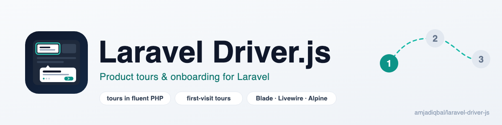
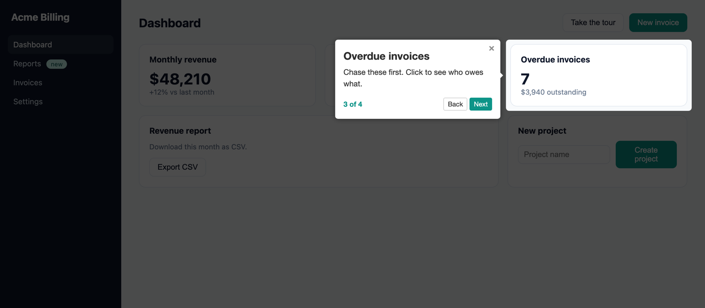

<p align="center">
  <picture>
    <source media="(prefers-color-scheme: dark)" srcset="art/banner-dark.png">
    
  </picture>
</p>

# Laravel Driver.js: product tours and onboarding for Laravel

Build [Driver.js](https://driverjs.com) product tours and onboarding walkthroughs in PHP, render them with
one Blade component, start them from a button, Alpine or Livewire, and show a tour only the first time a
visitor sees it (per browser).
No JavaScript to write, no npm build step.

[](https://packagist.org/packages/amjadiqbal/laravel-driver-js)
[](https://packagist.org/packages/amjadiqbal/laravel-driver-js)
[](LICENSE.md)

<p align="center">
  
</p>

```php
// In a controller: a welcome tour shown only the first time (per browser)
$tour = Driver::tour('welcome')
    ->once('welcome-v1')
    ->step(null, 'Welcome to Acme', 'A 30-second tour of where everything lives.')
    ->step('#revenue', 'Monthly revenue', 'Updated every hour.', ['side' => 'bottom'])
    ->step('#new-invoice', 'Create an invoice', 'Bill a customer in under a minute.');

return view('dashboard', ['tour' => $tour]);
```

```blade
{{-- In the view --}}
<x-driver-js :tour="$tour" />
```

## Why this package

Driver.js is the most used product-tour library on npm (about 1.4 million downloads a week). Using it in a
Laravel app usually means hand-writing a script per page, remembering who has already seen the tour, and
wiring it to Livewire yourself. This package does those parts for you:

- **Tours in PHP.** Steps and options are built with a fluent API that uses Driver.js's own option names, and
  invalid sides, alignments, buttons and hook names are rejected before they reach the browser.
- **Show once.** `once('welcome-v1')` auto-starts a tour only the first time a visitor sees it, per browser:
  it is remembered in `localStorage`, so the same person on another browser or device sees it again. Ship a
  new version of the tour by changing the key.
- **Start from anywhere.** A button with `data-driver-start`, an Alpine `$dispatch`, or `$this->startTour()`
  in a Livewire component, including after `wire:navigate`.
- **Safe output.** Tour text is escaped with `Js::from()`. Driver.js loads from a pinned jsDelivr URL with
  Subresource Integrity hashes, and the scripts carry Laravel's CSP nonce when you use one.

## Requirements

- PHP 8.3+
- Laravel 12 or 13
- Driver.js 1.x (1.10.2 is loaded by default; nothing to install)
- Optional: Livewire (tested with 4.4.7) and Alpine.js

## Installation

```bash
composer require amjadiqbal/laravel-driver-js
```

The service provider and the `Driver` facade are registered automatically. To change the defaults:

```bash
php artisan vendor:publish --tag=driver-js-config
```

## Usage

### A tour in Blade

Pass a tour built in PHP:

```blade
<x-driver-js :tour="$tour" />
```

Or write the Driver.js steps directly in the view:

```blade
<x-driver-js name="settings" :steps="[
    ['element' => '#profile', 'popover' => ['title' => 'Your profile', 'description' => 'Name, photo and email.']],
    ['element' => '#billing', 'popover' => ['title' => 'Billing', 'description' => 'Plans and invoices.', 'side' => 'left']],
]" :config="['showProgress' => false]" />
```

The first `<x-driver-js>` on a page prints the Driver.js stylesheet, script and a small runtime. To put them
in your `<head>` instead, add `@driverJsAssets` there.

### Building tours

```php
use AmjadIqbal\DriverJS\Facades\Driver;

Driver::tour('welcome')
    ->once('welcome-v1')             // auto-start only the first time
    ->manual()                       // or: never auto-start, wait for a trigger
    ->step('#search', 'Search', 'Find any customer.', ['side' => 'bottom', 'align' => 'start'])
    ->step(null, 'All set', 'A step with no element shows a centred popover.')
    ->showProgress(true, '{{current}} of {{total}}')
    ->buttonLabels(next: 'Next', previous: 'Back', done: 'Got it')
    ->overlayOpacity(0.6)
    ->overlayClickBehavior('nextStep')
    ->stagePadding(8)
    ->stageRadius(6)
    ->popoverClass('my-tour')
    ->allowKeyboardControl()
    ->set('smoothScroll', true);      // any other Driver.js option
```

One element instead of a tour:

```php
Driver::tour('export-hint')
    ->manual()
    ->highlight('#export', 'New: CSV export', 'Export any report to a spreadsheet.');
```

### Starting a tour

```blade
{{-- A button --}}
<button data-driver-start="welcome">Take the tour</button>

{{-- Alpine --}}
<button x-data @click="$dispatch('driver-js:start', { tour: 'export-hint' })">What's new?</button>
```

From a Livewire component:

```php
use AmjadIqbal\DriverJS\Livewire\StartsTours;

class CreateProject extends Component
{
    use StartsTours;

    public function save(): void
    {
        // ...
        $this->startTour('after-save');           // or $this->dispatch('driver-js:start', tour: 'after-save')
    }
}
```

The tour must be on the page (`<x-driver-js :tour="..." />`). It can highlight elements that the same
Livewire update has just rendered.

From JavaScript:

```js
LaravelDriverJs.start('welcome');        // returns the Driver.js instance
LaravelDriverJs.start('welcome', 2);     // from the third step
LaravelDriverJs.active()?.moveNext();    // control the running tour
LaravelDriverJs.reset('welcome-v1');     // forget that this browser has seen it
```

### Hooks

Connect any of the ten Driver.js hooks to a global function, by name or dot path:

```php
Driver::tour('welcome')->on('onDestroyed', 'App.tours.finished');
```

```js
window.App = { tours: { finished(element, step, { state }) { /* e.g. post to your API */ } } };
```

Hooks: `onPopoverRender`, `onHighlightStarted`, `onHighlighted`, `onDeselected`, `onDestroyStarted`,
`onDestroyed`, `onNextClick`, `onPrevClick`, `onCloseClick`, `onDoneClick`. They behave exactly as in
[Driver.js](https://driverjs.com/docs/configuration); for example, setting `onDestroyStarted` means you must
call `LaravelDriverJs.active().destroy()` yourself.

## Configuration

`config/driver-js.php`:

```php
'assets' => [
    'cdn' => true,   // false: you load Driver.js yourself (see below); the runtime is still printed
    'js' => 'https://cdn.jsdelivr.net/npm/driver.js@1.10.2/dist/driver.js.iife.js',
    'js_integrity' => 'sha384-…',
    'css' => 'https://cdn.jsdelivr.net/npm/driver.js@1.10.2/dist/driver.css',
    'css_integrity' => 'sha384-…',
],

'defaults' => [      // applied to every tour, then overridden by the tour's own options
    'showProgress' => true,
    'animate' => true,
    'allowClose' => true,
    'overlayOpacity' => 0.7,
    'stagePadding' => 8,
    'stageRadius' => 6,
],
```

To bundle Driver.js with Vite instead of the CDN, set `'cdn' => false`, run `npm i driver.js` and add to
`resources/js/app.js`:

```js
import { driver } from 'driver.js';
import 'driver.js/dist/driver.css';
window.driver = { js: { driver } };
```

To change the markup, publish the view with `php artisan vendor:publish --tag=driver-js-views`.

## Upgrading from 0.1

0.1 targeted the old Driver.js 0.x API and does not work with Driver.js 1.x. `addStep()`, `defineSteps()`,
`opacity()` and `onHighlighting()` still work and map to the new methods; `drive()`, `destroy()`, `moveNext()`
and `movePrevious()` were removed from the PHP builder. See the [changelog](CHANGELOG.md).

## Testing

```bash
composer test
scripts/ci-local.sh   # every PHP 8.3–8.5 × Laravel 12/13 combination, Pint and PHPStan
```

## Need this tour built into your app, or something custom?

I build onboarding flows, Livewire features and Laravel packages for teams. If you'd rather have your
product tour designed and wired up for you, or need something this package doesn't do,
[get in touch](https://amjad.com.pk/contact?utm_source=github&utm_medium=readme&utm_campaign=laravel-driver-js).

## Support

- 🐛 **Bug or feature request**: [open an issue](https://github.com/amjadiqbal/laravel-driver-js/issues)
- 🔒 **Security issue**: please report privately via GitHub's security tab

## Need this customised, or something built?

I'm available for custom development, package integration, and technical consulting.

[](https://www.upwork.com/freelancers/amjadkhatri)

## More packages

Part of a family of open-source packages. See [all of them](https://github.com/amjadiqbal?tab=repositories).

| | |
|---|---|
| [laravel-rough-notation](https://github.com/amjadiqbal/laravel-rough-notation) | Hand-drawn highlights and annotations for Blade |
| [laravel-tiptap](https://github.com/amjadiqbal/laravel-tiptap) | Tiptap editor for Laravel |
| [laravel-logpulse](https://github.com/amjadiqbal/laravel-logpulse) | Log health monitoring and alerting |
| [kiln](https://github.com/amjadiqbal/kiln) | Deploy-time OPcache control for Laravel |

## Credits

- [Driver.js](https://github.com/nilbuild/driver.js) by Kamran Ahmed (MIT), which does all the work in
  the browser. This package is an independent wrapper and is not affiliated with Driver.js.
- [Amjad Iqbal](https://amjad.com.pk)

## License

MIT. See [LICENSE.md](LICENSE.md).
